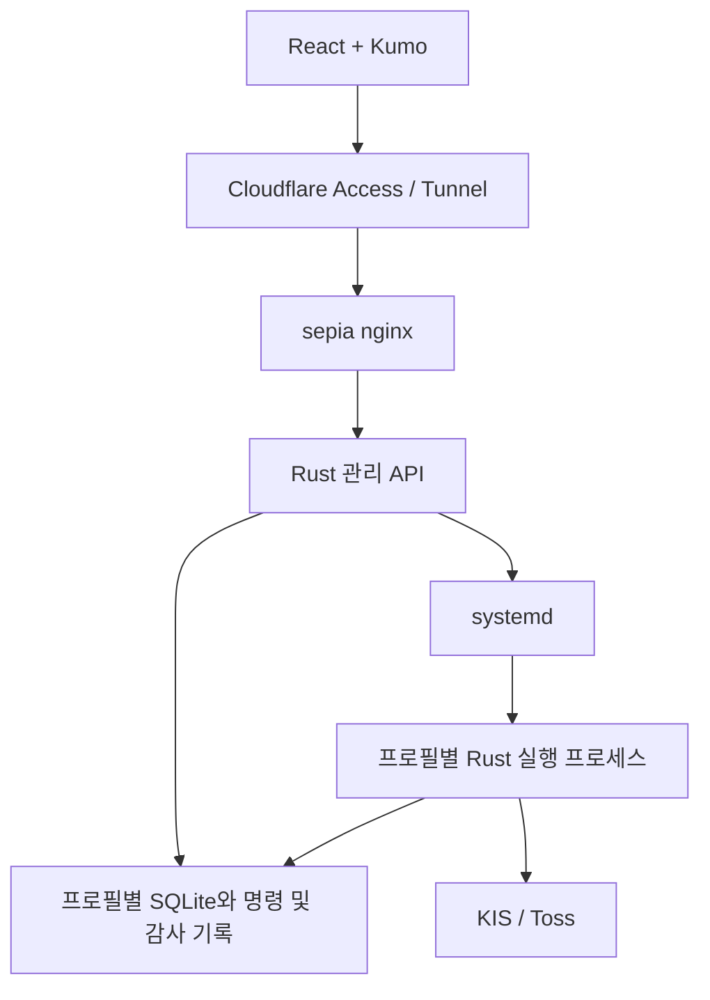

# Trading-agent 웹 관리 및 sepia 이전 계획

- 작성일: 2026-10-17
- 상태: 사용자와 기능 범위 및 주요 운영 정책을 합의한 구현 계획. 구현, 배포, 데이터 이전은 아직 수행하지 않았다.
- 대상 저장소: `trading-agent`, 인접한 `nix-flakes` 저장소.

## 목적과 문서의 위치

React 기반 웹 관리 화면에서 trading-agent의 상태와 거래 이력을 확인하고, KIS와 Toss의 거래, 프로세스, 설정, 운영 작업을 제어한다. 웹, 실행 프로세스, DB의 최종 운영 위치는 pylv-sepia다.

이 문서는 합의한 웹 관리 기능과 이전 절차를 기록한다. 기존 [AGENTS.md](../AGENTS.md)와 [PLAN_V4.md](../plans/PLAN_V4.md)의 우선순위를 바꾸지 않는다. 구현 첫 단계에서 PLAN_V4의 최소 운영 표면, 브로커 지원 범위, 복구 범위를 이 계획과 정합되게 갱신한다. 계획을 문서화한 것이 실제 주문, 자격 증명 변경, 서버 배포, DB 이전의 실행 승인을 의미하지는 않는다.

## 확정한 범위와 운영 정책

| 항목 | 확정 내용 |
| --- | --- |
| 프런트엔드 | React, TypeScript, Cloudflare Kumo를 사용한다. |
| Bun 역할 | 프런트엔드 의존성 관리, 개발, 빌드 도구로 사용한다. 운영 관리 API는 Rust가 담당한다. |
| 브로커 | KIS와 Toss를 함께 관리하며, Toss 실주문도 이번 완성 범위에 포함한다. |
| Toss 주문 범위 | 국내 및 미국 현금 주식의 정수 수량 주문, 정정, 취소를 완성한다. |
| 제외하는 Toss 주문 | 소수점 주문, 금액 주문, 조건 주문은 이번 범위에 포함하지 않는다. |
| 최종 배치 | 웹, KIS/Toss 실행 프로세스, DB를 모두 pylv-sepia로 이전한다. |
| 웹 노출 | nix-flakes의 기존 nginx와 Cloudflare Tunnel 구성을 확장하고 Cloudflare Access를 사용한다. |
| 장애 및 재부팅 복구 | 이전에 매매 중이던 프로필은 점검을 통과하면 자동매매까지 재개한다. |
| 사용자 중지 | 사용자가 명시적으로 중지한 프로필은 자동 복구가 다시 시작하지 않는다. |
| 긴급 동작 | 주문 차단을 기본으로 제공한다. 미체결 취소와 포지션 청산은 별도 동작이다. |
| 거래 실행 권한 | 웹의 수동 주문과 자동매매 모두 기존 결정론적 검증, 리스크, 실행, 감사 경로를 거친다. |

## 조사 기준선

다음은 2026-10-17의 저장소 및 읽기 전용 조사 결과다. 배포 직전에는 실행 상태와 데이터 크기를 다시 확인한다.

| 영역 | 확인한 상태 | 구현에 필요한 작업 |
| --- | --- | --- |
| KIS | 계좌와 시장 조회, 주문 실행, 정정/취소 라이브러리, reconciliation 기반이 있다. | 웹 명령 처리와 운영용 최종 정책 검사를 연결한다. |
| Toss | 계좌, 시세, 미체결 등 조회가 가능하다. 생성/정정/취소와 reconciliation은 차단되어 있다. | 실주문 transport, 상태 추적, 체결 조회, 복구 경로를 구현한다. |
| Toss 체결 | `list_fills`는 빈 배열을 반환한다. | 실제 조회를 구현하기 전에는 화면에서 '체결 없음'으로 표시하지 않는다. |
| CLI | `doctor`, `status`, `review`, `query`, `backtest`, `universe`, `run`이 있다. | 구조화된 내부 기능을 웹에서도 호출한다. |
| 관리 API | 웹 서버, 운영 명령 서비스, 프로세스 관리 API가 없다. | Rust 관리 계층을 추가한다. |
| 종료 처리 | 런타임에 Ctrl-C 기반 정상 종료 경로가 있다. | systemd SIGTERM과 종료 중 주문 복구를 연결한다. |
| 저장소 | SQLite와 제품 소유 migration, broker command journal을 사용한다. | 기존 데이터와 실행 경로를 유지하며 필요한 migration을 추가한다. |
| sepia 선언 | 기존 Cloudflare Tunnel과 loopback nginx origin 패턴이 있다. | trading-agent 패키지와 서비스를 추가한다. |
| Nix 배포 | 두 호스트에 trading-agent 서비스나 패키지가 선언되어 있지 않다. | 선언적 배포와 운영 문서를 작성한다. |

onyx의 현재 저장소 아래 `.local/state/trade-engine/`에서 다음 제품 DB를 확인했다. 제품 DB 5개 모두 스키마 버전 12였으며 journal mode는 `delete`였다.

| DB | 확인한 크기 |
| --- | ---: |
| `live-submit-orders-main.sqlite3` | 771,690,496 bytes |
| `overseas-submit-orders-main.sqlite3` | 5,965,770,752 bytes |
| `live-dry-run-main.sqlite3` | 196,608 bytes |
| `overseas-dry-run-main.sqlite3` | 245,760 bytes |
| `toss-dry-run-main.sqlite3` | 196,608 bytes |

기존 백업 파일과 KIS rate-limit SQLite도 별도로 존재한다. 조사 시점에 `trade-engine` 프로세스와 `trade*`/`trading*` 이름의 로드된 systemd unit은 보이지 않았다. 다른 이름의 자동 실행 경로까지 없다는 의미는 아니므로 이전 전에 전체 writer와 자동 시작 경로를 확인한다.

sepia SSH 확인은 호스트 키가 등록되어 있지 않아 실패했다. 호스트 검증은 완화하지 않았다. 실제 디스크 용량, 서비스 상태, 포트 사용 여부, Cloudflare hostname과 Access 정책은 미확인이다. Nix 선언과 실제 배포 상태를 구분한다.

## 운영 모델

### 프로필과 식별자

운영 프로필은 브로커, 계좌, 환경, 시장, 실행 모드, 설정 버전, DB를 연결한다. KIS 국내, KIS 미국, Toss 국내, Toss 미국을 별도 프로필로 실행하면서 한 화면에서 관리한다. 동일 거래 범위에 여러 writer가 생기지 않도록 시작과 주문 실행 경계에서 검사한다.

기존 DB는 첫 이전에서 합치지 않는다. 서로 다른 DB에 같은 숫자 ID가 존재할 수 있으므로 API와 화면은 프로필 ID와 레코드 ID를 함께 사용한다. 브로커 주문 식별자와 내부 명령 식별자도 분리한다.

현재 KIS 실행 잠금은 시장 범위를 포함한다. 구현 전에 계좌 단위 안전 조건과 시장별 동시 실행의 관계를 명세하고, 같은 계좌의 여러 프로필에서 리스크 한도와 실행 권한이 일관되게 적용되는지 검증한다. 이 검토를 이유로 기존 리스크 정책을 임의로 바꾸지는 않는다.

### 실행 의도, 프로세스, 거래 가능 상태

| 상태 | 예시 | 용도 |
| --- | --- | --- |
| 사용자가 원하는 상태 | 매매 실행, 일시정지, 중지 | 장애나 재부팅 이후 복원 대상을 판단한다. |
| 실제 프로세스 상태 | 시작 중, 실행 중, 종료 중, 실패 | supervisor와 heartbeat를 통해 실제 상태를 표시한다. |
| 거래 가능 상태 | 가능, 긴급 차단, 미해결 주문, 인증 오류 | 주문 실행 허용 여부와 차단 사유를 표시한다. |

사용자의 실행 의도는 영속적으로 저장한다. 프로세스 실패가 실행 의도를 지우지 않으며, 사용자 중지는 자동 재시작과 구분된다. 프로세스가 살아 있다는 사실만으로 거래 루프가 정상이라고 판단하지 않는다.

### 운영 명령

웹 요청은 명령 ID를 발급받고 실행 전에 저장된다. 명령에는 대상 프로필, 운영자, 사유, 요청 시각, 만료 시각, 설정 버전, 중복 방지 키, 처리 결과를 기록한다. 상태는 접수, 실행 중, 완료, 실패, 결과 확인 필요를 구분한다.

웹 서버는 거래 명령을 해당 실행 프로세스로 전달한다. 독립적인 두 번째 broker writer가 되지 않는다. 프로세스 시작/종료 명령은 supervisor가 처리하며, 거래 명령은 기존 실행 경로가 처리한다. 브라우저 이중 클릭과 HTTP 재시도는 동일 명령으로 처리한다.

연결이 끊기면 같은 명령의 상태를 다시 조회한다. 브로커에 도달했을 수 있는 명령을 자동으로 재전송하지 않는다. 만료되었거나 오래된 설정에 근거한 미실행 수동 주문은 재시작 뒤 늦게 실행하지 않도록 재검증한다.

## 화면과 기능

상단에는 브로커, 계좌, 국내/미국 시장, 환경, 실행 프로필을 표시한다. 모든 제어는 대상을 명확히 보여준다. 기본 화면은 한국어 데스크톱으로 설계하고, 모바일에서도 상태 확인과 긴급 차단을 사용할 수 있게 한다.

| 화면 | 조회 내용 | 제어 기능 |
| --- | --- | --- |
| 종합 현황 | 실행 상태, 마지막 정상 tick, 연결 상태, 데이터 지연, 주문 차단 사유 | 상세 이동, 프로필별 긴급 차단 |
| 계좌와 포트폴리오 | 현금, 주문 가능 금액, 보유 종목, 평가손익, 기록된 체결 | 최신 상태 조회, 종목 및 주문 상세 이동 |
| 주문과 체결 | 미체결, 체결, 거절, 결과 불명, 정정/취소 이력 | 지원 범위의 주문 생성, 정정, 취소, 상태 재확인 |
| 실행과 의사결정 | run, tick, 전략 신호, LLM 제안, 리스크 판정, 주문 결과 | 주문 생성부터 처리 결과까지 추적 |
| 프로세스 | PID, 시작 시각, 종료 사유, 재시작 횟수, 로그, heartbeat | 시작, 정상 종료, 재시작 |
| 전략과 설정 | 전략, 종목군, 실행 주기, sizing, exit, risk, advisor 설정 | 초안, 검증, 변경 비교, 적용 |
| 운영 작업 | doctor, universe 갱신, review/query, backtest 진행 상태와 결과 | 작업 실행 및 결과 조회 |
| 데이터와 감사 | DB 크기, 스키마, 백업 상태, 운영자 명령 이력 | 백업 실행, 감사 검색 |

데이터는 조회 시각과 오류 상태를 함께 표시한다. 미지원, 조회 실패, 실제 0건을 구분한다. 금액은 통화별로 표시하고, 환산 합계는 환율 출처와 기준 시각을 확보한 경우에 제공한다. 보유분에 소수점 수량이 있더라도 임의로 반올림하거나 누락하지 않고, 주문 가능한 정수 수량과 구분한다.

브로커별 지원 기능은 API에서 전달한다. 화면은 이를 기준으로 가격 정정, 수량 정정, 취소 가능 여부와 제한 사유를 표시한다. 현재 Toss가 반환하지 않는 데이터를 다른 브로커와 동일하게 지원하는 것처럼 표현하지 않는다.

## 기술 구조

React 정적 파일과 API는 같은 hostname으로 제공한다. Bun은 프런트엔드 도구로 사용한다. Vite와 Tailwind CSS v4를 프런트엔드 구성안으로, 기존 Tokio 런타임과 연결되는 Axum을 HTTP API 구성안으로 제안한다. 구체적인 의존성 버전은 구현 시 호환성을 확인하고 lockfile로 고정한다.

| 소유 위치 | 책임 |
| --- | --- |
| `web-admin/` | 화면, API 클라이언트, 프런트엔드 테스트 |
| `trade-engine` 관리 모듈 | 조회 모델, 운영 명령, 설정 버전, 작업 상태 |
| 별도 관리 서버 실행 진입점 | HTTP/SSE, 인증 신원, systemd 연동 |
| 기존 실행 모듈 | 거래 명령 처리, 리스크 검사, broker write, reconciliation |
| `trade-engine/migrations/` | 새 명령 및 운영 상태 테이블, 필요한 조회 인덱스 |
| `nix-flakes` | 패키징, 서비스, 자격 증명 전달, nginx, 백업 timer |

관리 서버는 엔진이 정지해도 조회와 프로세스 시작을 제공한다. CLI의 pretty/plain 출력을 파싱하지 않고 CLI와 웹이 같은 구조화된 제품 기능을 호출하도록 한다. broker credential과 거래 정책은 Rust 측에 유지한다.

조회는 초기 HTTP 요청과 SSE 상태 알림을 조합한다. 재연결 후 최신 상태를 다시 읽으며, 상태 스트림 자체를 거래 상태의 원장으로 사용하지 않는다. 금액과 가격은 Decimal의 정확도를 유지하는 문자열 계약으로 전달한다.

SQLite 조회는 서버 측 페이지 처리, 제한된 범위, 필요한 인덱스를 사용한다. 긴 조회가 거래 기록을 막지 않도록 연결과 트랜잭션 경계를 검증한다. 현재 journal mode에서 동시성 문제를 측정하고, WAL 전환 여부는 백업 및 복구 영향까지 검증한 뒤 결정한다.

## Toss 실주문 구현

### 공식 계약의 주요 제약

2026-10-17에 확인한 공식 OpenAPI 버전은 `1.2.24`다. 다음 계약은 구현 시 검토한 버전과 근거를 고정하고 테스트한다.

- 주문 생성은 `POST /api/v1/orders`, 정정과 취소는 각각 `POST /api/v1/orders/{orderId}/modify`, `POST /api/v1/orders/{orderId}/cancel`이다.
- 생성 요청의 `clientOrderId`는 10분 동안만 중복 방지 키로 동작한다. 이후 같은 키로 요청하면 새 주문이 된다.
- 생성 접수 응답은 체결 확인이 아니다. 정정/취소 응답에는 기존 주문과 다른 주문 ID가 반환되므로 관계를 저장해야 한다.
- 주문 조회 계약에는 client order ID 필터가 없다. broker order ID를 잃은 결과 불명 주문이 항상 자동 복구된다고 가정할 수 없다.
- 토큰 재발급은 같은 client의 기존 토큰을 즉시 무효화한다.
- 미국 주식 정정은 가격 변경만 지원한다. 국내 주식 정정에는 정수 수량이 필요하다.
- OPEN 주문 조회와 CLOSED 주문 조회의 페이지 처리 방식이 다르다. 날짜 필터는 체결일과 혼동하지 않는다.

공식 이용 안내는 호출 IP 등록과 client/API 그룹별 호출 제한을 요구한다. sepia의 실제 외부 접속 IP와 여러 프로세스가 공유하는 호출 예산을 배포 설계에 포함한다. 자세한 계약은 문서 끝의 공식 자료를 참조한다.

### 구현 순서

1. 공식 계약을 기준으로 fake-server 테스트를 작성한다. 메서드, 경로, 헤더, 요청 단위, 오류, 주문 상태, 페이지 처리를 검증한다.
2. 진행 중/종료 주문과 상세 조회, 누적 체결 정보를 구현한다. 누적 체결값을 broker가 제공한 개별 체결 이벤트로 오인하지 않도록 저장과 표시를 구분한다.
3. 같은 credential을 쓰는 국내/미국 프로세스와 doctor의 토큰 발급을 조정하고 호출 제한을 공유한다. 화면 갱신이나 진단이 실행 프로세스의 인증을 무효화하지 않아야 한다.
4. 내부 명령 ID, client order ID, broker order ID, 정정/취소 관계를 영속적으로 연결한다. broker write 전에 실행 요청과 journal을 저장한다.
5. 생성, 정정, 취소를 기존 리스크와 실행 workflow에 연결한다. 브로커 및 시장별 거래 시간, 가격, 수량 규칙을 적용한다.
6. timeout, 응답 유실, 부분 체결, 취소 경합, 프로세스 중단에 대한 복구를 구현한다. 결과가 불명확하면 조회로 확인하고, 충분한 근거가 없으면 미해결 상태와 신규 주문 차단을 유지한다.

현재 조회용 transport의 일반적인 일시 오류 분류를 write에 그대로 적용하지 않는다. 특히 정정/취소나 생성 결과가 불명확한 경우 자동 재전송으로 복구하지 않는다. 중복 방지 기간이 지났다는 이유로 journal을 지우거나 같은 주문을 다시 제출하지 않는다.

공개 명세에서는 모의투자 환경을 확인하지 못했다. 모의 환경이 없다고 단정하지 않으며, 로컬 계약 테스트와 장애 시뮬레이션을 먼저 완료한다. 실제 broker 주문 검증은 운영 전환 단계에서 별도로 수행한다.

## 프로세스, 설정, 긴급 제어

### 자동 복구

1. 영속적인 실행 의도와 적용 설정 버전을 읽는다.
2. DB, 자격 증명, 실행 잠금, 긴급 차단 상태를 확인한다.
3. 잔고, 미체결, 주문 결과를 다시 조회하고 미해결 명령을 조정한다.
4. 데이터와 시장 상태가 유효한지 확인한다.
5. 이전에 매매 중이던 프로필만 점검 통과 후 자동매매를 재개한다.

사용자 중지 상태와 긴급 차단은 재부팅이나 재시작으로 해제되지 않는다. 결과 불명 주문이 있으면 해당 프로필의 신규 주문 재개를 차단한다. 인증 오류나 재시작 반복은 로그와 명시적인 실패 상태로 표시한다.

### 종료와 별도 거래 동작

| 동작 | 효과 |
| --- | --- |
| 정상 종료 | 진행 중 작업을 정리하고 실행 루프를 종료한다. 이미 접수된 주문은 남는다. |
| 전략 일시정지 | 새 전략 주문 생성을 멈춘다. 조회와 주문 상태 확인은 계속한다. |
| 긴급 주문 차단 | 영속 차단 상태를 설정하고 주문 실행 직전에 검사한다. 기존 주문을 자동 취소하거나 포지션을 청산하지 않는다. |
| 미체결 취소 | 명시적으로 선택한 주문에 취소 요청을 제출하고 결과를 추적한다. |
| 포지션 청산 | 새 전략 주문 중단, 보유 및 미체결 조회, 주문 미리보기, 필요한 취소, 매도, 잔여 포지션 확인을 수행한다. |

취소와 청산이 별도 동작이라는 결정은 긴급 차단을 우회할 권한을 의미하지 않는다. 구현 전에 명령별 차단 상태, 해제 조건, 최종 리스크 검사 조합을 명세한다. 차단을 암묵적으로 해제하거나 기존 정책을 우회하지 않는다. 청산은 부분 성공, 실패, 결과 불명과 잔여 수량을 표시하는 작업으로 관리한다.

systemd SIGTERM을 정상 종료 경로와 연결한다. 제한 시간을 넘긴 종료와 강제 종료는 구분해서 기록하고, 다음 시작에서 reconciliation을 수행한다. 종료 버튼을 누른 것과 실제 종료가 완료된 것을 구분한다.

### 설정 변경

설정 변경은 초안 저장, 검증, 변경 비교, 적용, 실제 적용 버전 확인 순서로 수행한다. 초기 버전의 실행 중 설정 변경은 명시적인 재시작으로 적용한다. 사용자가 원하는 실행 상태와 적용한 설정 버전을 함께 보존한다.

전략과 리스크 등의 검증 가능한 필드는 웹에서 편집한다. advisor 실행 파일이나 임의 셸 명령은 배포 설정에서 관리한다. 비밀 값은 화면, 로그, API 응답에 노출하지 않고 자격 증명의 준비 및 오류 상태만 보여준다.

## Nix 배포

| 예상 변경 위치 | 역할 |
| --- | --- |
| `hosts/pylv-sepia/trading-agent.nix` | 전용 서비스 계정, 상태 디렉터리, 프로필 서비스, 관리 API, nginx origin, 백업 timer |
| `hosts/pylv-sepia/configuration.nix` | 신규 모듈 import |
| `packages/apps/trading-agent/`, `packages/default.nix` | 고정된 소스 버전으로 Rust 및 프런트엔드 패키징 |
| 필요한 agenix 선언 | sepia 서비스에 자격 증명 전달 |
| sepia README와 관련 패키지 문서 | 배포, 서비스 운영, Cloudflare 연결, 백업 및 복구 |

기존 Cloudflare Tunnel을 재사용하고 origin은 loopback에 바인딩한다. `trading.pylv.dev`는 hostname 후보이며 아직 확정하거나 설정하지 않았다. origin 포트도 실제 사용 상태를 확인한 후 정한다.

현재 public hostname과 Access 정책은 Cloudflare 대시보드가 소유한다. Nix 변경과 별도 원격 설정 작업으로 관리한다. 앱은 검증된 Access 신원을 운영 기록에 연결하고, 변경 요청에는 origin/CSRF 검사를 적용한다. 별도 비밀번호 시스템은 추가하지 않는 구성안이다.

서비스는 개발 checkout에 의존하지 않는 고정된 배포 산출물을 사용한다. 비밀 값은 Nix store나 프런트엔드 번들에 포함하지 않는다. 프로세스 제어 권한은 정해진 trading-agent 서비스에 한정한다.

## DB 및 실행 환경 이전

SQLite와 실행 프로세스를 sepia에 함께 둔다. onyx가 네트워크 파일시스템을 통해 sepia의 SQLite를 직접 여는 구성은 사용하지 않는다. 첫 이전에서는 DB별 데이터와 식별자를 유지하고 웹/API에서 통합 조회한다.

### 전환 절차

1. DB, 설정, 바이너리 및 스키마 버전, 영속 상태, 자격 증명 전달, advisor 실행 환경, 자동 시작 경로를 목록화한다. 잠금과 토큰 캐시는 감사 데이터와 구분한다.
2. sepia의 용량과 서비스 계정을 확인한다. 주요 DB만 약 6.74GB이므로 전송 사본, 검증 사본, 백업 보관 공간을 별도로 계산한다.
3. 일관된 SQLite 백업으로 복구 연습을 한다. 스키마, 무결성, 주요 테이블 건수와 최신 기록, 파일 권한을 비교한다.
4. sepia의 실제 외부 접속 IP와 Toss 허용 IP를 확인하고, 승인된 절차로 자격 증명과 실행 환경을 준비한다.
5. 최종 전환 시 onyx의 모든 writer와 자동 시작 경로를 정지한다. 두 호스트의 로컬 잠금은 서로를 막지 못하므로 원본 writer 종료를 별도로 확인한다.
6. 최종 백업을 전송하고 검증한다. source DB와 필요한 복구 자료는 보존한다.
7. sepia를 거래 비활성 상태로 시작하고 데이터 조회, 서비스 상태, broker 잔고와 미체결, reconciliation을 확인한다.
8. 승인된 운영 전환 시점에 실행 의도를 활성화한다. 과거 실행 상태만 복사했다고 최초 이전 직후 자동으로 주문을 시작하지 않는다.
9. 정기 백업, 별도 호스트 보관, 복구 시험을 구성한다. 보관 기간과 복구 목표는 용량과 보관 위치를 확인한 후 정한다.

실행 중인 DB 파일을 단순 복사하는 대신 SQLite의 일관된 snapshot 방식을 사용한다. 백업 작업을 위해 거래 서비스를 매일 정지하는 정책을 기존 다른 서비스에서 그대로 복사하지 않는다.

### 복구 경계

sepia가 새 broker 주문이나 감사 기록을 만들기 전에는 보존한 source와 버전 정보를 기준으로 전환을 취소할 수 있다. sepia에서 새 상태가 발생한 뒤에는 과거 onyx 사본으로 단순 복귀하지 않는다. sepia writer 정지, 최신 상태 보존, 필요 시 역이전, broker 상태 재조정을 포함하는 복구 절차를 따른다.

## 단계별 산출물과 완료 기준

| 단계 | 산출물 | 완료 기준 |
| --- | --- | --- |
| 1. 운영 모델과 계약 | PLAN_V4 정합화, 프로필과 명령 상태, API 계약, 화면 흐름, 지원 기능 목록 | 각 제어의 대상, 효과, 실패 및 복구 동작이 명확하다. |
| 2. Toss 실주문 기반 | 정확한 조회, 공유 인증과 호출 제한, 주문 생성/정정/취소, journal 연계, reconciliation | 정상, 거절, 부분 체결, 결과 불명을 계약 및 장애 테스트로 구분한다. |
| 3. Rust 관리 API | 조회, 영속 명령, 설정, 작업, HTTP/SSE | CLI와 웹이 같은 제품 로직을 사용하고 명령 결과를 재조회할 수 있다. |
| 4. 프로세스와 복구 | systemd 연동, 정상 종료, 시작 점검, 실행 의도 복원 | 중복 writer 없이 사용자 중지와 자동 재개 정책을 지킨다. |
| 5. 웹 관리 화면 | 통합 현황, 계좌, 주문, 감사, 프로세스, 설정, 운영 작업 | KIS와 Toss의 지원 기능을 구분해 웹에서 조회하고 제어한다. |
| 6. 배포와 이전 | Nix 패키지와 서비스, Cloudflare 연결, DB 복구 연습 및 전환 절차 | 기존 이력을 보존하고 실행 호스트를 sepia로 단일화한다. |
| 7. 통합 검증과 운영 전환 | 장애 검증, 데이터 규모 검증, 백업 복원, 승인된 실운영 확인 | 두 브로커의 거래와 복구 동작을 검증하고 미해결 사항을 기록한다. |

1단계 계약을 정한 뒤 Toss 클라이언트 작업과 조회 API/화면 작업은 파일 소유권을 나누어 병행할 수 있다. 실제 주문 제어 연결은 주문 및 복구 계약을 검증한 뒤 수행한다. Toss 실주문은 선택적 후속 단계가 아니라 전체 완료 조건이다.

## 검증 계획

### 거래 및 복구 시나리오

- 브라우저 이중 클릭과 HTTP 재시도가 중복 주문을 만들지 않는다.
- Toss 중복 방지 기간을 넘긴 결과 불명 주문을 자동 재전송하지 않는다.
- broker ID를 얻지 못한 명령을 근거 없이 완료하거나 실패로 확정하지 않는다.
- 정정/취소 응답 유실과 부분 체결 경합에서도 주문 관계와 잔여 수량을 보존한다.
- 국내/미국 프로세스와 doctor의 동시 실행이 토큰을 무효화하거나 호출 제한을 독립적으로 소진하지 않는다.
- 재부팅 후 이전에 매매 중이던 프로필만 점검을 통과하면 자동 재개한다.
- 사용자 중지와 긴급 차단이 재시작 후에도 유지된다.
- SIGTERM과 강제 종료를 구분하고, 전송 가능성이 있는 주문은 재시작 후 조회로 복구한다.
- 오래된 설정이나 만료된 수동 명령을 뒤늦게 실행하지 않는다.
- 프로필과 브로커가 다른 레코드의 동일 숫자 ID를 혼동하지 않는다.

### 화면, 데이터, 배포

- 미지원, 조회 실패, 실제 0건, 오래된 데이터를 구분한다.
- 소수점 보유분과 통화별 금액을 정확히 표시하며 주문 가능 범위를 별도로 안내한다.
- Access 세션 만료와 SSE 재연결 후 상태를 다시 확인한다.
- 현재 주요 DB 약 6.74GB 규모에서 페이지 조회가 거래 처리를 방해하지 않는다.
- 이전 전후 주문과 감사 이력을 비교하고 onyx/sepia의 동시 writer가 없음을 확인한다.
- 백업 사본을 실제로 복원하고 무결성과 주요 이력을 확인한다.

Rust 구현은 TDD와 저장소의 필수 `cargo check`, `cargo fmt`, `cargo clippy`, `cargo test`, `cargo doc` 검사를 따른다. 프런트엔드는 타입, 빌드, 주요 화면 및 제어 흐름을 검증한다. Nix는 변경 범위에 맞는 포맷과 정적 검사를 먼저 수행하고 필요한 경우에만 평가 및 빌드 검증을 추가한다.

## 남은 확인 사항

| 항목 | 필요한 확인 |
| --- | --- |
| sepia 접속 및 용량 | 검증된 SSH 접근, 여유 공간, 실제 서비스와 포트 상태 |
| Cloudflare | hostname, Tunnel route, Access application 및 정책 |
| Toss 실행 환경 | sepia 외부 접속 IP, 허용 목록, credential 공유 범위 |
| advisor 실행 환경 | 서비스 계정의 실행 파일, 인증 상태, 작업 디렉터리, 필요한 환경 |
| 최초 이전 대상 | 추가 DB나 다른 이름의 자동 시작 경로 존재 여부 |
| 백업 | 별도 보관 위치, 보관 기간, 복구 목표 |
| 명령별 정책 | 긴급 차단 중 취소/청산의 처리와 명시적인 해제 조건 |
| Toss 결과 불명 | 자동으로 증명할 수 없는 주문의 운영자 확인 절차 |

## 근거 자료

### 저장소

- [현재 CLI](../trade-engine/src/runner/args.rs)
- [설정과 Toss write 차단](../trade-engine/src/config/mod.rs)
- [공통 gateway](../trade-engine/src/gateway/traits.rs)
- [KIS adapter](../trade-engine/src/gateway/adapters/kis.rs), [Toss adapter](../trade-engine/src/gateway/adapters/toss.rs)
- [실행 workflow](../trade-engine/src/execution/workflow.rs), [reconciliation](../trade-engine/src/reconciliation/mod.rs)
- [SQLite와 migrations](../trade-engine/src/storage/mod.rs)
- [Toss client](../toss-client/src/client.rs), [transport](../toss-client/src/transport.rs), [인증](../toss-client/src/auth.rs)

nix-flakes의 조사 근거는 `hosts/pylv-sepia/configuration.nix`, `hosts/pylv-sepia/menu.nix`, `hosts/pylv-sepia/ghost.nix`, `hosts/pylv-sepia/README.md`, `packages/default.nix`다. 이 경로는 trading-agent가 아닌 인접한 nix-flakes 저장소 기준이다.

### 공식 문서

아래 자료는 2026-10-17에 확인했다. 구현 시 검토한 계약 버전을 기록하고 변경 여부를 재확인한다.

- [Toss OpenAPI JSON](https://openapi.tossinvest.com/openapi-docs/latest/openapi.json), 확인 버전 `1.2.24`.
- [Toss 이용 안내와 호출 제한](https://openapi.tossinvest.com/openapi-docs/overview.md).
- [Kumo 설치](https://kumo-ui.com/installation/).
- [Bun과 Vite](https://bun.sh/guides/ecosystem/vite).
- [Axum](https://docs.rs/axum/latest/axum/).
- [Cloudflare Access JWT 검증](https://developers.cloudflare.com/cloudflare-one/access-controls/applications/http-apps/authorization-cookie/validating-json/).
- [SQLite Backup API](https://www.sqlite.org/backup.html).
- [SQLite 네트워크 사용 제약](https://www.sqlite.org/useovernet.html).
